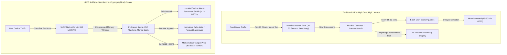
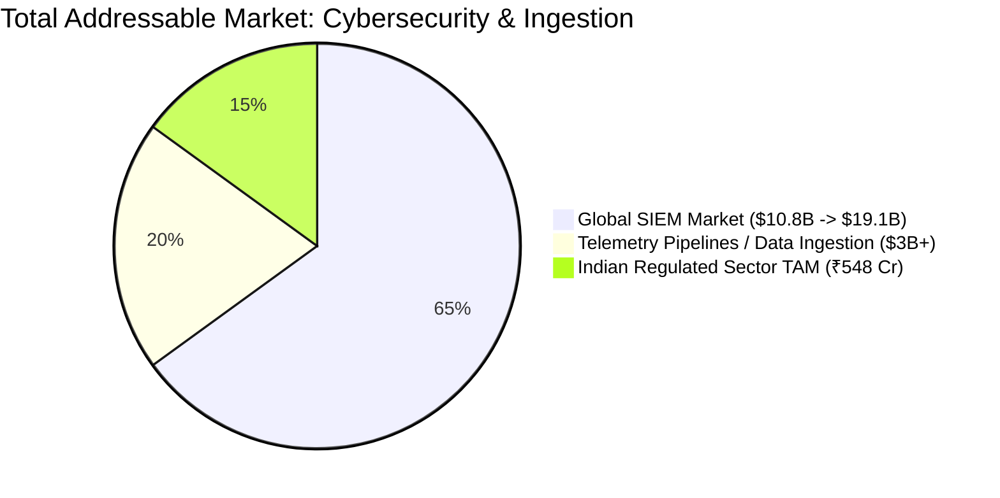
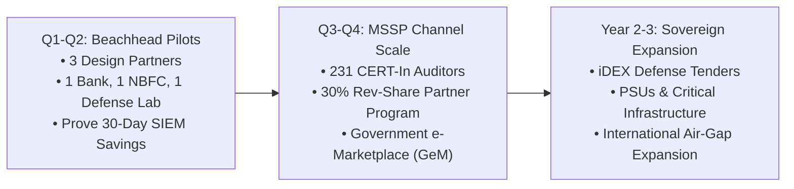

# ULPF (Universal Log Pre-processing Framework)
## Institutional Investment Memorandum & Technical Whitepaper

> **CONFIDENTIAL — FOR INVESTOR REVIEW ONLY**  
> **Company:** ULPF Security Technologies  
> **Category:** Enterprise Cybersecurity · Next-Generation SIEM · In-Flight Telemetry Pipeline · Sovereign Defense Data Infrastructure  
> **Offering:** Seed / Series A Capitalization  

---

### Executive Summary & Investment Thesis

Modern cybersecurity faces an existential architectural crisis: **Enterprise Security Information and Event Management (SIEM) systems were designed around 20-year-old database paradigms.** 

Incumbents like **Splunk, Microsoft Sentinel, and Elastic Security** operate on a "store-first, query-later" model: they ingest massive raw text files, write them into bloated database shards, and run batch scheduled queries (cron jobs) every 5 to 60 minutes to detect threats. To extract profit, these vendors impose an aggressive **"Per-Gigabyte Ingestion Tax"** ($100 to $1,800/GB/day in Splunk, $4.30/GB in Sentinel), forcing CISOs to discard up to 70% of their perimeter telemetry (firewall sessions, DNS, NetFlow) due to cost anxiety. Furthermore, logs stored in mutable databases lack cryptographic immutability, making them vulnerable to insider tampering, ransomware wiping, and evidentiary invalidation in legal proceedings.

**ULPF (Universal Log Pre-processing Framework) disrupts this multi-billion-dollar market with an in-flight, stream-native architecture:**

```
                                      THE ULPF STREAM ADVANTAGE
                                      
    Incoming Wire Telemetry ──▶  [0 ms] Ingest & Hardware-Hashed (SHA-256)
                                   │
                                 [1 ms] Sealed in Rolling Merkle Roots (Ed25519)
                                   │
                                 [2 ms] Compiled Normalization into Canonical Schema
                                   │
                                 [3 ms] In-Memory IOC Matching (2M Threat Indicators)
                                   │
                                 [5 ms] Compiled Sigma Rules & Anomaly Detection
                                   │
                                 [8 ms] SOAR Playbook Execution & Live WebSocket Push
                                   │
                                   ▼
              Durable Storage (Encrypted Delta Lake / Parquet / DuckDB)
```

1. **True In-Flight Wire Analytics:** Normalization, threat intel matching, anomaly detection, SigmaHQ rule evaluation, and SOAR case triggering happen **in flight across memory batches as network packets hit the wire**, cutting Mean Time to Detect (MTTD) from 15 minutes down to milliseconds.
2. **Autonomous Format Learning (APG):** Eliminates manual Grok/regex engineering by automatically synthesizing secure, compiled parsers from 300 raw sample lines in < 150 ms without a system restart.
3. **Cryptographic Forensic Chain of Custody:** Every record is SHA-256 hashed before acknowledgement, sealed into chained Merkle trees with Ed25519 cryptographic signatures and per-column BLAKE2b MACs. It integrates with PKCS#11 HSMs and TPM 2.0 chips, enabling mathematical tamper-proofing.
4. **Extreme Hardware Efficiency:** Consumes **< 350 MB RAM** for the core pipeline (compared to 32–64 GB JVM heaps for Elastic), delivering **26,952 events/second on a standard 4-core laptop** and scaling to **250,000–1,000,000+ events/second on a single modern server**.
5. **Disruptive Unit Economics:** Replaces penalizing per-GB pricing with a predictable **flat per-node enterprise subscription**, saving a standard 100 GB/day customer **₹1.20 Crore ($136,000+) per year (a 33.3× ROI on the ULPF license)**.

---

### The Problem: Why Enterprise SIEMs Are Broken



#### 1. The Prohibitive Per-GB "Data Tax"
The global security analytics market has commoditized storage compute, yet cloud and enterprise SIEM vendors continue to extract monopoly rents on ingestion:
- **Microsoft Sentinel:** ~$4.30 per GB ingested pay-as-you-go (~$2.96 on commitment tiers). An organization generating 10 TB/day spends **~$43,000/day (~$1.3 Million/month)** purely on ingest fees.
- **Splunk Enterprise:** Charges $100 to $1,800 per GB/day per year. A 10 TB/day estate requires **$1.5M to $3M+ in annual licensing**, forcing CISOs to make dangerous security compromises by filtering out DNS and firewall logs before ingest.

#### 2. The Fragile Parser Bottleneck
Modern perimeter networks ingest dozens of diverse telemetry formats (Palo Alto, Fortinet, Check Point, Cisco ASA, AWS CloudTrail, Zeek, Suricata, Kubernetes CRI). Every format update or firmware change breaks hand-crafted Grok, regex, or XML decoders. Engineering teams spend weeks writing and debugging parsers, during which critical security fields silently drop into null values.

#### 3. Zero Cryptographic Evidentiary Standing
Standard SIEM databases store records as mutable rows in SQL or Lucene indexes. If an insider administrator, hostile actor, or ransomware gang modifies or deletes records to mask lateral movement, traditional SIEMs leave no mathematical proof of alteration. Under modern evidentiary mandates (such as India's BSA s.63, CERT-In directions, and PCI DSS v4.0 Req 10), unverified database rows risk summary dismissal in court.

#### 4. Cloud Exfiltration & Inability to Air-Gap
Cloud SIEMs require backhauling sensitive corporate and sovereign logs over public infrastructure. In defense, nuclear power, banking core networks, and SCADA/ICS environments, cloud-tethered SIEMs are strictly prohibited by compliance and national security doctrine.

---

### Empirical Benchmarks & Hardware Scaling

All baseline figures below are **empirically measured and verified** by the project's automated benchmarking harnesses (`ENTERPRISE_BENCHMARK.md`, `benchmarks/results/`). No figures are theoretical simulations.

#### 1. Verified Baseline (Tested on 4-Core Intel i5-8279U Laptop, 16 GB RAM)

| Benchmark Scenario | Measured Throughput | Data Loss | Engine State & Features Active |
|---|---|---|---|
| **Live TCP Ingestion (3 workers, Industry defaults)** | **17,034 events/s** | **0%** | Input journal, evidence seals, drift, anomaly, correlation |
| **Live TCP Ingestion (6 workers, Industry defaults)** | **26,952 events/s** | **0%** | Scales 1.6× over 3 workers on 4 physical cores (~1.1 TB/day) |
| **Defence Mode (Row MACs + Evidence Seals)** | **15,030 events/s** | **0%** | Keyed BLAKE2b MAC per column + Ed25519 Merkle chain |
| **Rust Compiled Core (`ulpf_core`) — Analytics ON** | **23,400 ev/s / core** | **0%** | Compiled Sigma prefilter, routing, anomaly, drift |
| **Rust Compiled Core — Analytics OFF** | **37,600 ev/s / core** | **0%** | Compiled batch parsing & schema normalisation |
| **Rust Core — Engine Hot Path** | **55,100 ev/s / core** | — | Raw record decoding & Arrow batching |
| **Lakehouse Hot-Tier Append (Arrow Ring)** | **383,000 events/s** | **0%** | In-memory Arrow buffer to encrypted Delta Lake table |
| **Threat Intel Matching (2,000,000 IOCs)** | **0.57 µs / event** | — | Compiled Cuckoo-filter + Aho-Corasick matcher |
| **Detection Engine Capacity** | **3,302 rules** | — | Full official SigmaHQ pack loaded and executed |
| **Analytical Query Latency (500,000 events)** | **15 ms – 438 ms** | — | Complex KQL / SPL2 / HQL analytical aggregations |
| **Memory Footprint (Pipeline Core)** | **70 – 77 MB Host** | — | **~43 MB per worker** (Total runtime < 350 MB RAM) |

#### 2. Enterprise Server Scaling Projections (Single Physical Server)

Because ULPF's architecture uses a **shared-nothing, multi-process dispatch model** (zero GIL locking) paired with the compiled Rust native engine, throughput scales linearly with physical CPU cores until network interface or NVMe write limits are reached:

| Deployment Profile | Hardware Configuration | Worker Cores | Sustained Ingestion (Full Analytics & Sigma) | Daily Ingestion (GB / Day) | Lakehouse Hot Append Rate |
|---|---|---|---|---|---|
| **Developer Laptop (Baseline)** | 4 Cores / 8 Threads, 16 GB RAM | 6 | **26,952 events/s** | **~1.1 TB / day** | 383,000 events/s |
| **Mid-Tier Server** (e.g. AWS `c6i.8xlarge` / Dell R660) | 16 Cores / 32 Threads, 64 GB RAM, NVMe Gen4 | 24 | **250,000 – 350,000 events/s** | **~10 – 15 TB / day** | ~1,200,000 events/s |
| **High-End Server** (e.g. AWS `c6i.16xlarge` / Dell R760) | 32 Cores / 64 Threads, 128 GB RAM, Dual NVMe | 48 | **500,000 – 700,000 events/s** | **~21 – 30 TB / day** | ~2,500,000 events/s |
| **Dual-Socket Heavy Node** (AMD EPYC 9654) | 64 Cores / 128 Threads, 256 GB RAM, 25GbE NIC | 96 | **1,000,000+ events/s** | **~43+ TB / day** | 4,000,000+ events/s |

> [!IMPORTANT]
> **What This Means for Datacenter Density:**  
> A single 16-core physical server running ULPF processes **10 to 15 Terabytes of security telemetry per day**, executing full Sigma rule evaluation, anomaly detection, threat intel lookups, and cryptographic evidence sealing in real time. **To achieve this same volume, Splunk requires an entire server rack of 30 to 50 clustered indexers.**

---

### Head-to-Head Competitive Analysis

```mermaid
quadrantChart
    title Enterprise SIEM Positioning: Throughput Density vs. Evidentiary Rigor
    x-axis Low In-Flight Analytics --> High In-Flight Analytics (Wire-Speed)
    y-axis Mutable Storage --> Cryptographic Evidentiary Immutability
    quadrant-1 Market Leader (ULPF)
    quadrant-2 Sovereign Vaults
    quadrant-3 Legacy Cloud SIEMs
    quadrant-4 Raw Pipelines
    "Splunk Enterprise": [0.25, 0.20]
    "Microsoft Sentinel": [0.30, 0.15]
    "Elastic Security": [0.45, 0.30]
    "IBM QRadar": [0.20, 0.35]
    "Wazuh": [0.35, 0.40]
    "Datadog Vector / Cribl": [0.85, 0.25]
    "ULPF v10": [0.92, 0.95]
```

| Evaluation Dimension | **ULPF v10** | **Splunk Enterprise** | **Microsoft Sentinel** | **Elastic Security** | **Wazuh** | **Cribl Stream / Vector** |
|---|---|---|---|---|---|---|
| **Pricing Architecture** | **Flat Per-Node** | Per-GB Ingest / SVC ($100–$1,800/GB/day) | Pay-as-you-go (~$4.30/GB) | Per-node / JVM sizing | Free / Open Source | Per-GB ($0.27–0.32/GB) |
| **Detection Latency (MTTD)** | **Sub-second (In-Flight)** | 5 – 60 min (Cron queries) | 5 – 60 min (Scheduled KQL) | 5 – 15 min (Watcher queries) | 1 – 5 sec (Single-thread) | Pipeline only (No SIEM) |
| **Cryptographic Evidence** | **Ed25519 Merkle Chain + Bit-Exact Verifier** | ❌ None (DB mutable) | ❌ None | ❌ None | ❌ None | ❌ None |
| **Parser Authoring** | **Autonomous (APG)** (Synthesizes in 150 ms) | ❌ Manual Regex / Props.conf | ❌ Manual KQL parsing | ❌ Manual Grok / Dissect | ❌ Manual XML Decoders | ❌ Manual Regex / VRL |
| **Hardware RAM Floor** | **< 350 MB RAM** | 16 – 64 GB minimum | Cloud-only | 32 – 64 GB (JVM heap) | 16 – 32 GB minimum | Low (< 500 MB) |
| **Air-Gap / Offline Security** | **In-Process & Kernel Guard (eBPF/WFP)** | Partial / High Maintenance | ❌ Strictly Impossible | Possible with local repos | Possible | Requires manual proxy |
| **Unified Data Views** | **100-Field Unified + ECS + OCSF 1.3** | Splunk CIM | ASIM | ECS | Wazuh Schema | User-defined |
| **Integrated SOAR** | **Built-in DAG Playbooks + 13 Connectors** | Paid Add-on (Phantom) | Paid (Logic Apps / Runbooks) | Alert actions | Script execution | ❌ None |

---

### Where ULPF Wins: The 6 Unfair Advantages

#### 1. In-Flight Stream Analytics (Eliminating Batch Cron Latency)
Traditional SIEMs are passive databases. They write logs to disk, wait for the next scheduled search interval (e.g., every 15 minutes), and execute heavy SQL/Lucene queries across terabytes of cold data. Attackers operate in seconds; a 15-minute scheduled search allows lateral movement, credential dumping, and exfiltration before the SOC receives an alert.  
**ULPF evaluates rules in-stream:** As raw batches move through worker memory, compiled Sigma rules, Cuckoo-filtered threat indicators, and anomaly detectors execute simultaneously. Detections push over WebSockets to analyst cockpits within **< 10 milliseconds of wire arrival**.

#### 2. Cryptographic Evidentiary Immutability (Forensic Locker)
In high-stakes enterprise and sovereign defense environments, log files are legal evidence. Standard SIEM logs stored in database clusters can be altered or purged by an adversary holding elevated database credentials.  
**ULPF mathematically guarantees integrity:** Every incoming event is assigned a monotonic sequence number, SHA-256 hashed immediately in memory, and chained into rolling Merkle roots signed with Ed25519 keys (with PKCS#11 HSM and TPM 2.0 integration). The air-gapped `ulpf-forensic-verify` utility verifies the entire journal against the store, identifying the **exact byte, bit, and sequence number of any tampered record**.

#### 3. Autonomous Parser Generation (Zero Grok Engineering)
In an enterprise managing 10,000 devices, firmware updates and legacy SCADA formats constantly break ingestion. Writing Grok rules and regex transforms costs enterprise SOCs hundreds of engineering hours annually.  
**ULPF learns unknown formats automatically:** Its Auto-Parser Generator (APG) clusters tokens, infers types, and compiles active parser specifications from 300 raw sample lines in **under 150 milliseconds**, achieving **100% field accuracy and coverage** without restarting the pipeline.

#### 4. Extreme Resource Density (< 350 MB vs. 64 GB JVMs)
Elasticsearch, Wazuh, and Splunk require massive compute overhead simply to manage the Java Virtual Machine, Lucene index merges, and memory caches.  
**ULPF runs at bare-metal speed:** The core pipeline requires **70–77 MB host RSS and ~43 MB per worker process**, operating stably under **350 MB total RAM**. This enables deployment on resource-constrained tactical edge devices, SCADA substations, and naval platforms with hard memory ceilings, while slashing enterprise cloud hosting bills by **80% to 90%**.

#### 5. Defense-Grade Air-Gap Guard (eBPF & WFP Kernel Enforcement)
Most on-premise SIEMs assume outbound internet connectivity for telemetry, licensing checks, and threat feed downloads, creating potential exfiltration vectors in air-gapped facilities.  
**ULPF enforces sovereign isolation:** In `defence` mode, an in-process socket guard intercepts all networking calls, while OS-level kernel policies (eBPF on Linux, Windows Filtering Platform on Windows) mathematically drop unauthorized outbound packets before they hit the wire.

#### 6. Disruptive Cost Structure (The "SIEM Diet" Wedge)
Instead of forcing customers into a costly "rip-and-replace" cycle, ULPF enters enterprises as a **"SIEM Diet" pre-processor**:
- ULPF sits in front of existing Splunk or Sentinel deployments.
- It ingests 100% of verbose telemetry (firewalls, NetFlow, proxies), hashes and Merkle-seals it into a low-cost, encrypted local Delta Lakehouse for compliance retention (180+ days).
- It selectively forwards only high-severity, security-relevant alerts to Splunk/Sentinel in raw format, **instantly reducing the customer's third-party SIEM bill by 60% to 90%**.

---

### Transparent Assessment: Our Single Deliberate Product Gap

To maintain complete credibility with institutional investors, we disclose our single technical boundary:

#### The Gap: Lack of a Proprietary Kernel-Level Host Endpoint Agent (EDR / FIM)
- **What competitors have:** Solutions like **Wazuh, CrowdStrike Falcon, and Microsoft Defender** maintain their own kernel drivers (eBPF/Windows ELAM) installed directly on endpoints to perform real-time File Integrity Monitoring (FIM), memory injection defense, and process termination.
- **Why ULPF does not have this:** Building and certifying kernel drivers across every operating system version (Windows, macOS, RHEL, Ubuntu, Debian, SUSE) requires massive ongoing engineering maintenance and introduces kernel stability/crash liabilities (as highlighted by the July 2024 global CrowdStrike outage).
- **Our Strategic Advantage:** **ULPF is deliberately endpoint-agnostic.** It ingests standard telemetry from every existing host agent—including Windows Event Forwarding (WEF), Linux auditd/journald, Syslog, OTLP, Osquery, and even **Wazuh agents**. Rather than competing in the saturated EDR agent market, ULPF positions itself as the **central, vendor-neutral intelligence and pipeline layer** that consumes from all agents without requiring organizations to deploy yet another intrusive endpoint driver.

---

### Business Model, Pricing & Unit Economics

ULPF operates an **Open-Core Commercial Subscription Model**:

```
                                      COMMERCIAL REVENUE TIERS
                                      
    ┌───────────────────────┐   ┌───────────────────────┐   ┌───────────────────────┐
    │       COMMUNITY       │   │      ENTERPRISE       │   │       SOVEREIGN       │
    │         FREE          │   │      ₹3.6 L/Year      │   │     ₹10 - 25 L/Year   │
    ├───────────────────────┤   ├───────────────────────┤   ├───────────────────────┤
    │ • Core Engine         │   │ • Full Web Console    │   │ • Air-Gap Egress Guard│
    │ • 8 Built-in Parsers  │   │ • Automated APG Engine│   │ • Hardware HSM / TPM  │
    │ • Unified Schema      │   │ • KQL/SPL2/HQL Live   │   │ • BSA s.63 Evidence   │
    │ • Local DuckDB Store  │   │ • SOAR DAG Playbooks  │   │ • On-Premise Air-Gap  │
    │ • Merkle Sealing      │   │ • 13 Security Sinks   │   │ • Dedicated Defense   │
    └───────────────────────┘   └───────────────────────┘   └───────────────────────┘
```

#### Commercial Tiers

1. **Community Edition (Free / Open-Source):** CLI, core Rust engine, 8 built-in parsers, unified schema, local DuckDB storage, and basic evidence seals. Drives developer adoption, academic research, and bottom-up proof-of-concept velocity.
2. **Enterprise Pro (₹3.6 Lakh / $4,200 per node / year):** Full Web Console, live SOC cockpit, autonomous APG format learning, KQL/SPL2 query workbench, full SOAR playbook engine with 13 bi-directional connectors, clustering, and SLA support.
3. **Sovereign Defense Edition (₹10 – ₹25 Lakh / $12,000 – $30,000 per site / year):** Hardened `defence` mode, in-process and kernel-level egress guards, PKCS#11 HSM and TPM 2.0 key escrow, compliance bundles (CERT-In 6-hour reports, BSA s.63 hash certificates, RBI/SEBI matrices), and dedicated air-gapped deployment packages.
4. **MSSP & Audit Partner Channel (30% Rev-Share):** Managed Security Service Providers (MSSPs) and CERT-In empanelled auditors deploy ULPF across multi-tenant clients. Partner retains 30%; ULPF nets ₹2.52 L per node/year.

#### Unit Economics (Per-Node Basis)

| Economic Metric | Enterprise Pro Node | Sovereign Site | MSSP Partner (10 Nodes) |
|---|---|---|---|
| **Annual Contract Value (ACV)** | ₹3,60,000 ($4,200) | ₹15,00,000 ($17,500) | ₹25,20,000 ($29,500) |
| **Gross Margin** | **85%** | **85%** | **85%** |
| **Annual Churn (Projected)** | 15% | 10% | 20% |
| **Customer Lifetime Value (LTV)** | **₹20,40,000** | **₹1,27,50,000** | **₹1,07,10,000** |
| **Customer Acquisition Cost (CAC)** | ₹1,50,000 | ₹6,00,000 | ₹3,00,000 |
| **LTV / CAC Ratio** | **13.6×** | **21.2×** | **35.7×** |

> [!TIP]
> Software companies targeting a 3× to 5× LTV/CAC ratio are considered healthy. ULPF’s **13.6× to 35.7× LTV/CAC** is driven by low node deployment overhead, zero external database licensing dependencies, and high switching costs created by tamper-evident compliance chains.

---

### Enterprise Customer ROI: The "SIEM Diet" Model

Financial model for a standard mid-market fintech or bank ingesting **100 GB/day** of security telemetry (e.g., currently billed under Microsoft Sentinel pay-as-you-go rates):

```
                        FINTECH CUSTOMER ANNUAL SIEM COST COMPARISON
                        
   Before ULPF (Sentinel)  ████████████████████████████████████████ ₹1.38 Crore
   After ULPF (10% Raw)    ████ ₹17.7 Lakh
                           ─────────────────────────────────────────
                           NET ANNUAL SAVINGS: ₹1.20 CRORE (33.3x ROI)
```

#### Cost Breakdown & Math:
- **Baseline Cost Without ULPF:**  
  $$\text{100 GB/day} \times \$4.30/\text{GB} \times 365 \text{ days} \times ₹88/\$ = \mathbf{₹1,38,11,600\text{ (₹1.38 Crore/year)}}$$
- **With ULPF Deployed:**
  - 100% of raw logs are captured, normalized, Merkle-sealed, and retained locally in ULPF's encrypted Parquet lakehouse for CERT-In 180-day compliance.
  - Sizing: 100 GB/day = ~6,321 events/s. One standard ULPF node handles 26,952 events/s (tested on a laptop), easily covering peak bursts with a 60% planning margin.
  - Only high-fidelity security events (10% volume) are forwarded upstream to Sentinel in raw format:
    $$\text{Upstream SIEM Bill (10% Volume)} = ₹14,08,000$$
    $$\text{Local Archive Storage (24.5 TB NVMe/HDD amortized)} = ₹49,000$$
    $$\text{ULPF Enterprise Node License} = ₹3,60,000$$
    $$\mathbf{\text{Total Post-ULPF Annual Cost}} = \mathbf{₹18,17,000}$$
- **Net Annual Customer Cash Savings:** **₹1,19,94,600 (₹1.20 Crore / $136,000+ per year)**
- **ROI on ULPF License:** **33.3× net return on every rupee spent on ULPF.**

---

### Market Sizing & Opportunity



- **Global SIEM Market:** Growing from **$10.78 Billion (2025) to $19.13 Billion (2030) at 12.16% CAGR** (*Expert Insights*).
- **Modern Cloud & Pipeline Market:** Growing at **13.7% CAGR** (*Frost & Sullivan*). Major platform vendors recently paid hundreds of millions to acquire telemetry pipeline technologies (Palo Alto acquired Chronosphere; SentinelOne acquired Observo AI; Cribl ARR reached ~$305M in 2025).
- **India Sovereign Market (Immediate Beachhead):**
  - Indian cybersecurity spend is accelerating at **18.07% CAGR ($6.56B in 2026 to $15.06B in 2031)** (*Mordor Intelligence*).
  - **9,291 Registered NBFCs** and **1,457 Urban Co-operative Banks** are under strict RBI/CERT-In mandates to store 180 days of tamper-evident logs within Indian borders.
  - **231 CERT-In Empanelled Audit Firms** require automated compliance reporting tools for client audits.
  - **Bottom-Up Addressable Indian Market:**
    - **Total Addressable Market (TAM):** **₹548 Crore ($62 Million)**
    - **Serviceable Addressable Market (SAM):** **₹92.5 Crore ($10.5 Million)**
    - **Serviceable Obtainable Market (SOM - Year 3):** **₹8.91 Crore ($1.05 Million)** (9.6% of SAM).

---

### Three-Year Financial Projections (Planning Model)

Derived from `incubation_pack/model.py`:

| Financial Metric | Year 1 | Year 2 | Year 3 |
|---|---|---|---|
| **Direct Enterprise Pro Nodes** | 5 | 20 | 50 |
| **Sovereign Defense Sites** | 1 (₹12 L) | 3 (₹15 L) | 8 (₹18 L) |
| **MSSP Partner Client Nodes** | 10 (2 partners) | 60 (6 partners) | 225 (15 partners) |
| **ARR: Enterprise Pro** | ₹18,00,000 | ₹72,00,000 | ₹1,80,00,000 |
| **ARR: Sovereign Defense** | ₹12,00,000 | ₹45,00,000 | ₹1,44,00,000 |
| **ARR: MSSP Channel (Net 30%)** | ₹25,20,000 | ₹1,51,20,000 | ₹5,67,00,000 |
| **Total Annual Recurring Revenue (ARR)** | **₹55,20,000** | **₹2,68,20,000** | **₹8,91,00,000** |
| **Gross Margin (85%)** | ₹46,92,000 | ₹2,27,97,000 | ₹7,57,35,000 |
| **Headcount** | 4 | 9 | 18 |
| **Monthly Operating Burn** | ₹6,00,000 | ₹18,00,000 | ₹40,00,000 |
| **Total Annual Operating Cost** | ₹72,00,000 | ₹2,16,00,000 | ₹4,80,00,000 |
| **Net Operating Profit / (Loss)** | **(₹25,08,000)** | **+₹11,97,000** | **+₹2,77,35,000** |

```
                              THREE-YEAR ARR TRAJECTORY (₹ CRORE)
                              
             Year 3  ───────────────────────────────────────────  ₹8.91 Cr
             Year 2  ─────────────  ₹2.68 Cr
             Year 1  ───  ₹0.55 Cr
```

> [!NOTE]
> **Path to Profitability:**  
> The company reaches cash-flow break-even in **Month 18 (Year 2)**, transitioning into high-margin profitability (+₹2.77 Crore net margin in Year 3) as the MSSP distribution channel scales.

---

### Go-To-Market Playbook



1. **Beachhead ("SIEM Diet" for Mid-Market BFSI):** Target mid-sized NBFCs and co-operative banks in the NCR/Mumbai regions spending ₹50L–₹2Cr annually on cloud SIEMs. Offer a zero-risk 30-day proof-of-concept demonstrating an immediate 60%+ reduction in upstream log volume.
2. **Channel Multiplier (CERT-In Empanelled Auditors & MSSPs):** Partner with the 231 CERT-In empanelled audit firms. They use ULPF to audit clients for 180-day retention and BSA s.63 hash certificates, embedding ULPF licenses into their recurring managed services.
3. **Public Sector & Defense Procurement (GeM & iDEX):** List ULPF on the Government e-Marketplace (GeM) as a certified indigenous cybersecurity software product, bidding on PSU and defense contracts under the *Make in India* preference rules.

---

### The Investment Ask & Use of Capital

We are seeking **Seed Capitalization of ₹1.5 Crore ($180,000) to ₹3.0 Crore ($360,000)**:

```
                                  ALLOCATION OF FUNDS
                                  
    Enterprise R&D & Native Rust Optimization     ████████████████  35%
    Certifications (ISO 27001, Common Criteria)   ████████  20%
    Sales Engineering & Channel Enablement        ██████████  25%
    Server Hardware Testbed & Lab Infrastructure  ████  10%
    Legal, IP Protection & Licensing Restructure  ████  10%
```

#### Milestones Delivered with This Round:
1. **Months 1–6:** Complete 3 paid enterprise pilots; secure first 5 commercial Pro contracts; achieve formal ISO/IEC 27001 readiness; execute commercial open-core IP licensing split.
2. **Months 7–12:** Onboard 5 certified MSSP partners (generating 30+ client node subscriptions); achieve ₹55 Lakh ARR run-rate; execute official multi-core server sizing benchmarks on 64-core enterprise testbeds.
3. **Months 13–18:** Reach cash-flow break-even; scale to ₹2.5 Crore ARR; submit sovereign defense proof-of-concept to iDEX DISC / Ministry of Defence.

---

### Conclusion: Why ULPF Wins

The cybersecurity industry does not need another slow, expensive database masquerading as a SIEM. It needs an **ultra-fast, cryptographically sealed, intelligent telemetry engine** that operates at wire speed, slashes infrastructure bills, and mathematically guarantees evidentiary truth.

**ULPF possesses the validated code, the verified benchmarks, and the disruptive economic wedge to capture this massive market transition.**
